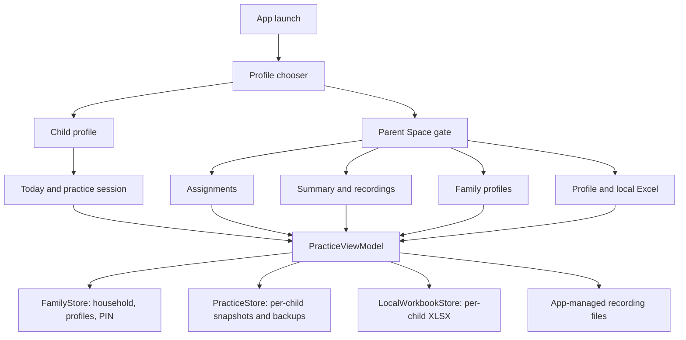

# LK Practice baseline and Phase B foundation

Date: October 31, 2026
Plan source: `LK_Practice_Plan.docx` from `LK_Practice_Plan.zip`

> This file records the Phase B baseline. Phase C and the subsequent local
> family-control checkpoint are now complete; see `LK_PRACTICE_PHASE_C.md` and
> `LK_PRACTICE_PHASE_D_LOCAL_CONTROLS.md` for current behavior.

## Product boundary

LK Practice remains one local-first Android app. A child enters a named practice
profile in one tap. Assignments, summaries, profile management, local files, and
video sharing are inside a protected Parent Space.

This foundation does not add cloud accounts, teacher invitations, cross-device
sync, uploaded recordings, billing, or online consent management. Those require
authenticated server-side authorization and remain later phases.

## Audited baseline

| Capability | Status after this change | Notes |
| --- | --- | --- |
| Child Today screen | Implemented | Sky-themed mission-first flow is preserved. |
| Listen / play-along / solo modes | Implemented, partially configurable | Modes are generic model data; the adult editor does not yet expose per-assignment mode selection. |
| Assignments | Implemented | Generic title, instrument, focus, notes, optional reference, clip, repetitions, and optional sheet music. |
| Practice sessions | Implemented | Per-child session records track mode, start/end, status, and repetitions completed in that session. |
| Daily progress and recordings | Implemented | Local timing, repetitions, completion, events, and private CameraX recordings. |
| Weekly progress and reflection | Missing | Planned for the next practice-engine phase. |
| Household and child profiles | Implemented | Multiple named children can use different instruments with isolated data. |
| Parent protection | Implemented as a local gate | Salted four-digit PIN; this is not an online account or verifiable parental consent system. |
| Teacher role and sharing | Missing | Requires authenticated, scoped backend authorization. |
| Persistence | Implemented locally | Per-child JSON snapshots in SharedPreferences with last-known-good backup recovery. |
| Excel and CSV | Implemented locally | Assignments move both ways; exports include explicit student and instrument ownership. |
| Cloud sync | Missing by design | No Drive, Sheets, or YouTube account connection. |
| Recording sharing and deletion | Implemented for parents | Child practice can watch a just-recorded take; sharing and deletion stay in Parent Space. |
| Whole-profile export/deletion | Missing | Required before a public child-focused release. |

## Current architecture

The current stack is Kotlin, Jetpack Compose, CameraX, a constrained YouTube
WebView player, Android's Storage Access Framework, and a hand-written XLSX
reader/writer. There is no backend.

## Foundation completed from the plan

1. Added `Household` and `ChildProfile`; migrated the former single profile.
2. Added an LK Practice profile chooser with named child cards and Parent Space.
3. Added a local parent PIN gate and guarded all adult mutations, summaries,
   file operations, sharing, and recording deletion.
4. Generalized `PracticeTask` into `Assignment` while retaining a type alias for
   source compatibility.
5. Added explicit student and instrument ownership to assignments, progress,
   events, sessions, CSV, and Excel.
6. Added `PracticeSession` with active, completed, and interrupted states.
7. Added a no-reference assignment type so a mission can be practice-only.
8. Preserved the child-facing sky design and reduced adult controls to the
   protected workspace.
9. Rebranded visible UI and new workbook names to LK Practice while preserving
   compatibility identifiers needed for existing installations.

## Upgrade and migration behavior

- The Android application ID remains `com.practicepartner.music`, so the new APK
  upgrades the installed app rather than creating a second app.
- The existing `practice_partner_v2` preferences file remains in use.
- Existing single-profile keys become the first `ChildProfile`.
- The existing global practice snapshot is claimed by the first migrated child,
  copied into `snapshot_v5:<child-id>`, and not deleted during migration.
- Legacy records without an owner are assigned to the migrated child. Records
  explicitly owned by another child are filtered out.
- Each new child receives a separate snapshot, revision counter, workbook
  configuration, assignments, progress, events, sessions, and recordings view.
- Existing “Practice Partner” recording directories and FileProvider paths are
  retained internally so older recordings remain accessible after the visible
  LK Practice rebrand.
- Existing LK Practice or legacy Practice Partner workbooks are accepted when
  their required sheets and markers are valid; the next save upgrades them to
  the current columns.

## Parent-gate behavior

- A parent creates a four-digit PIN on first entry to Parent Space.
- Only a salted SHA-256 digest is stored locally.
- Adult access locks when returning to child practice, switching profiles, or
  sending the app to the background.
- Android's document picker is treated as a continuation of an already
  authorized adult action so selecting a workbook, video, sheet, or CSV does
  not fail when the picker temporarily backgrounds the app.
- The PIN is a shared-device convenience gate, not account authentication.
  There is not yet PIN reset/recovery, remote revocation, or teacher identity.

## Regression checklist

Automated:

- [x] Existing and new unit tests compile and pass.
- [x] Legacy five-column CSV remains importable.
- [x] Current CSV/XLSX ownership columns round-trip.
- [x] A row owned by another student is rejected.
- [x] No-reference assignments round-trip.
- [x] Legacy blank ownership migrates to the active child and other-child data is removed.
- [x] Generated XLSX files contain every required sheet and heading.

Manual before distributing an APK:

- [x] Upgrade an emulator containing the existing Lincoln profile without clearing app data.
- [x] Confirm Lincoln's assignments and progress remain visible. The test emulator had no saved recording file to inspect.
- [ ] Add a second child with a different instrument and confirm both directions of isolation.
- [x] Confirm tapping Parent Space shows the PIN-creation gate before any adult tool.
- [ ] Background and reopen Parent Space; confirm it relocks.
- [ ] Create and reconnect a separate workbook for each child.
- [ ] Start, pause, finish, and force-close practice; confirm session status and repetitions.
- [ ] Verify camera, microphone, YouTube, local video, sheet music, share, and delete flows.
- [ ] Check large text, screen-reader labels, contrast, and target phone sizes.

## Known gaps and ordered next work

1. Complete the manual migration and two-child isolation checklist.
2. Add assignment-level practice-step selection and a one-question reflection.
3. Add gentle weekly practice patterns without streak penalties or skill scores.
4. Add parent-controlled profile export and deletion, including managed media.
5. Define the target age band, consent approach, privacy policy, and store
   disclosures before public release.
6. Only then design authenticated accounts, teacher invitation/revocation, and
   private cloud synchronization. Local Excel remains portability, not the
   shared system of record.
